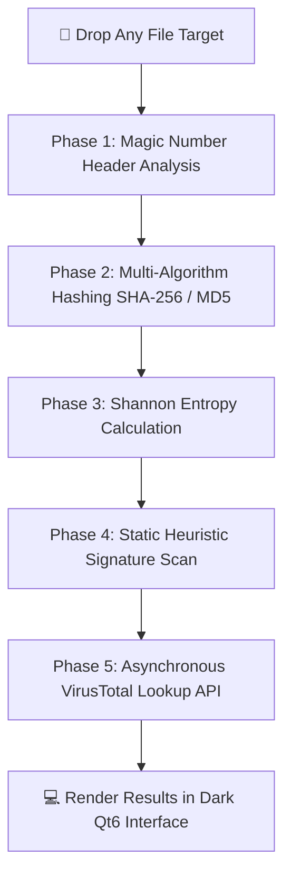

<div align="center">


### 🛡️ Next-Gen Forensic File Analysis & Threat Detection Platform 🚀

[](https://github.com/epicmajid)
[](https://www.microsoft.com/windows)
[](https://www.python.org)
[](https://doc.qt.io/qtforpython/)
[](LICENSE)
[](#)

<br/>

[`#cybersecurity`](https://github.com/topics/cybersecurity) 
[`#forensics`](https://github.com/topics/forensics) 
[`#reverse-engineering`](https://github.com/topics/reverse-engineering) 
[`#virustotal`](https://github.com/topics/virustotal) 
[`#pyside6`](https://github.com/topics/pyside6) 
[`#python-security`](https://github.com/topics/python-security)

---

</div>

## 📌 Executive Summary

**SENTINEL** is a high-performance, dark-themed static binary inspection tool engineered for **security analysts**, **reverse engineers**, and **developers**. Built with Python 3.10 and PySide6 (Qt6), SENTINEL provides deep structural insights into any file format (Executables, Images, Documents, and Archives) without needing to execute untrusted code.

From reading magic numbers and inspecting PE header anomalies to querying VirusTotal APIs and visualizing entropy levels, **SENTINEL** packs full-scale malware static analysis into an intuitive cyberpunk interface.

---

## 🔥 Key Highlights & Features

| Feature | Capabilities & Technical Specs |
| :--- | :--- |
| **🔬 Universal File Parser** | Parses `PE`, `ELF`, `MACH-O`, `PDF`, `Zip/Archive`, and generic binaries seamlessly. |
| **🧠 Deep Magic Number ID** | Reads initial binary magic bytes (e.g., `MZ`, `PK`, `\x7fELF`) to bypass spoofed extension tricks. |
| **🛡️ Heuristic Threat Engine** | Uses fast, pure-Python pattern scanners to detect Ransomware indicators, keyloggers, and reverse shells. |
| **🌐 VirusTotal v3 API Hub** | Computes `MD5`, `SHA-1`, `SHA-256` hashes and queries 70+ Antivirus engines via VT Cloud API. |
| **📊 Shannon Entropy Visualizer** | Graphically highlights high-entropy sections (Signals packed, obfuscated, or encrypted payloads). |
| **🖼️ Built-in Media Renderer** | Dynamic preview panel for PNG, JPG, BMP, and SVG files with metadata extraction (EXIF). |
| **🔍 Interactive Hex & ASCII Explorer**| Ultra-fast memory-efficient Hex viewer with ASCII regex filtering and string extraction. |

---

## 🏗️ Architecture & Technical Stack

SENTINEL is architected around modular static-analysis sub-routines:



### 💻 Technologies & Libraries
- **GUI Engine:** [PySide6](https://pypi.org/project/PySide6/) (Qt for Python 6)
- **Asynchronous Execution:** Qt `QThread` pool to ensure zero UI freezes during heavy analysis.
- **Crypto & Math:** Native `hashlib`, `math`, `re` modules for high-speed string and entropy math.
- **API Integration:** `requests` / `urllib3` with rate-limiting and cache handling for VirusTotal REST v3 API.

---

## 📸 Interface Showcase

<div align="center">

| **SENTINEL Cyberpunk Interface Preview** |
| :---: |
|  |
| *Sleek dark-mode terminal layout featuring universal drag-and-drop file inspection.* |

</div>

---

## 🚀 Quick Start (Executable & Source)

### Option 1: Standalone Portable Executable (`.exe`) 📦

If you just want to run **SENTINEL** without installing Python:

1. Download the latest binary release from the **[Releases](../../releases)** page.
2. Unpack `SENTINEL.zip`.
3. Launch `SENTINEL.exe` *(No installation required, completely portable)*.

---

### Option 2: Running from Source 🐍

#### Prerequisites
- **OS:** Windows 10/11 *(Linux/macOS support coming soon)*
- **Python:** `3.10` or higher

1. **Clone the Repository:**
   ```bash
   git clone https://github.com/epicmajid/sentinel.git
   cd sentinel
   ```

2. **Create a Virtual Environment:**
   ```bash
   python -m venv venv
   # On Windows
   .\venv\Scripts\activate
   ```

3. **Install Dependencies:**
   ```bash
   pip install -r requirements.txt
   ```

4. **Launch SENTINEL:**
   ```bash
   python main.py
   ```

---

## ⚡ Binary Optimization & Compression Notes

To guarantee maximum execution speed and minimum distribution footprint, **SENTINEL** is optimized using **PyInstaller** paired with **UPX (Ultimate Packer for Executables)**.

> 💡 **Developer Note:** Unused Qt modules are excluded to reduce standard builds from ~85 MB down to ~20 MB.

```bash
# Recommended Optimized Build Command
pyinstaller --noconfirm --onedir --windowed \
    --name "SENTINEL" \
    --icon=assets/icon.ico \
    --exclude-module PySide6.QtWebEngine \
    --exclude-module PySide6.Qt3D \
    --exclude-module PySide6.QtNetworkAuth \
    --add-data "assets;assets/" main.py
```

### 📉 Compression Benchmarks

| Build Strategy | Output Type | Binary Size | Launch Speed |
| :--- | :---: | :---: | :---: |
| Standard Build (No UPX) | `--onedir` | ~85 MB | Instant (~0.4s) |
| **Optimized + UPX** | `--onedir` | **~24 MB** | **Fast (~0.5s)** |
| Standalone Packed | `--onefile` + UPX | **~18 MB** | Direct (~1.2s) |

---

## 🗺️ Roadmap & Upcoming Features

- [x] Initial PE & Universal Static Analysis
- [x] VirusTotal API v3 Hash Lookup Integration
- [x] High-Speed Hex Dump & ASCII Extraction
- [ ] **YARA Rules Engine Support:** Custom external `.yar` rule file loading.
- [ ] **PE Section Inspector:** Deep PE section parsing (`.text`, `.rsrc`, `.reloc`).
- [ ] **Cross-Platform Release:** Native Linux & macOS PyQt builds.

---

## 🤝 Contributing

Contributions are what make the open-source community an incredible place to learn, inspire, and create. Any contributions you make are **greatly appreciated**!

1. **Fork** the Project.
2. Create your Feature Branch (`git checkout -b feature/AwesomeFeature`).
3. **Commit** your Changes (`git commit -m 'Add some AwesomeFeature'`).
4. **Push** to the Branch (`git push origin feature/AwesomeFeature`).
5. Open a **Pull Request**.

---

## 👤 Developer Profile

<div align="center">

<a href="https://github.com/epicmajid">
  
</a>

| **Lead Developer** | **GitHub Profile** | **Project Repository** |
| :---: | :---: | :---: |
| **Majid** | [@epicmajid](https://github.com/epicmajid) | [epicmajid/sentinel](https://github.com/epicmajid/sentinel) |

</div>

---

## 📜 License

Distributed under the **MIT License**. See [`LICENSE`](LICENSE) for more details.

<div align="center">
  <sub>Engineered with ⚡ & ❤️ by <a href="https://github.com/epicmajid">@epicmajid</a></sub>
</div>