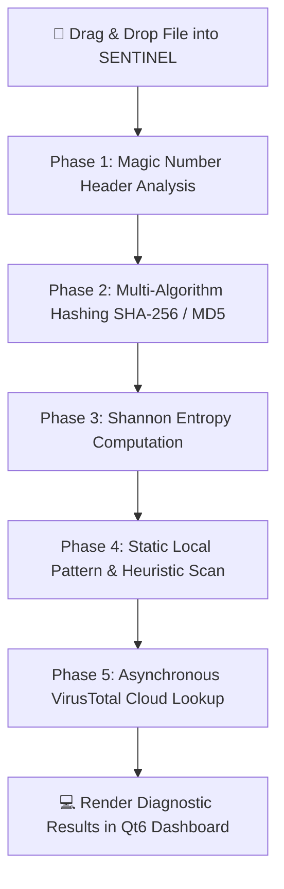

# 🛡️ S E N T I N E L
### Universal File Inspector & Threat Analysis Platform

 

[`#cybersecurity`](https://github.com/topics/cybersecurity)
[`#file-inspector`](https://github.com/topics/file-inspector)
[`#malware-analysis`](https://github.com/topics/malware-analysis)
[`#static-analysis`](https://github.com/topics/static-analysis)
[`#forensics`](https://github.com/topics/forensics)
[`#sentinel`](https://github.com/topics/sentinel)

---

## 📌 Executive Overview

**SENTINEL** is a modern, high-performance static forensic file analyzer engineered to inspect untrusted or unknown files safely without risk of execution.

Built with Python 3.10 and PySide6 (Qt6), **SENTINEL** empowers cybersecurity enthusiasts, malware analysts, and power users to peer directly into binary structures—extracting deep forensic data, checking magic numbers, analyzing section entropy, and querying cloud threat intelligence APIs seamlessly within a dark cyber-themed interface.

---

## 💡 Why SENTINEL?

Untrusted downloads often hide malicious intent behind fake file extensions (such as renaming `.exe` to `.jpg`) or heavy binary obfuscation. **SENTINEL** solves this by executing pure static analysis:

* **Bypass Extension Spoofing:** Reads raw binary magic numbers (`MZ`, `PK`, `\x7fELF`) to verify the file's true signature.
* **Detect Encryption & Packers:** Calculates Shannon Entropy metrics (0.00 – 8.00) to expose packed malware payloads or encrypted payloads.
* **Safe Inspection Environment:** View ASCII strings, hex dumps, and header metadata without executing potential malware on your system.

---

## 🔥 Key Technical Features

| Feature | Capabilities & Engineering Highlights |
| :--- | :--- |
| **🔬 Universal File Parsing** | Deep structural inspection for PE executables, PDFs, Zip archives, images, and raw binaries. |
| **🧠 Header Magic Byte Engine** | Instant signature detection reading initial bytes to accurately reveal true MIME and file types. |
| **🛡️ Local Heuristic Scanner** | Built-in Python rule-matching engine to detect ransomware hooks, keyloggers, and shellcode patterns. |
| **🌐 VirusTotal v3 Cloud API** | Automatic hash computation (`MD5`, `SHA-256`) with asynchronous lookup against 70+ AV engines. |
| **📊 Shannon Entropy Metrics** | Graphical indicator highlighting entropy scores; high ratings alert to obfuscation or packed code. |
| **🔍 Hex Dump & String Explorer** | High-speed hex viewer with interactive ASCII/Unicode string extraction and filtering. |
| **🖼️ Embedded Preview Panel** | Native rendering panel for media, EXIF data, and images inside a sandboxed UI tab. |

---

## 📸 Interface Showcase

| **SENTINEL Dark Qt6 Interface** |
| :---: |
|  |
| *Intuitive drag-and-drop workflow featuring side-by-side analysis tabs and real-time entropy status.* |

---

## 🔄 Static Analysis Execution Lifecycle

---

## 🚀 Installation & Deployment

**SENTINEL** is distributed as a standalone, portable Windows executable (`.exe`) requiring zero installation or background runtime setups.

### Running the Executable (`.exe`) 📦

1. Download the latest release archive from the **[Releases](../../releases)** section.
2. Extract the contents of `SENTINEL.zip`.
3. Double-click `SENTINEL.exe` to launch the application immediately.

---

## ⚡ Binary Optimization & Compression

To deliver maximum portability and quick startup times, the binary package is optimized using **PyInstaller** and compressed with **UPX (Ultimate Packer for Executables)**:

* **Size Reduction:** Reduced total runtime size from **~85 MB** down to **~20 MB**.
* **Antivirus Note (False Positives):** Due to UPX binary packing, certain heuristic antivirus software (like Windows Defender) may trigger a *False Positive* warning. **SENTINEL is 100% safe, open-source, and non-destructive.**

---

## 👤 Developer Profile

| **Lead Developer** | **GitHub Profile** | **Project Repository** |
| :---: | :---: | :---: |
| **Majid** | [@epicmajid](https://github.com/epicmajid) | [epicmajid/sentinel](https://github.com/epicmajid/sentinel) |

---

## 📜 License

This project is licensed under the **MIT License**. See the [`LICENSE`](LICENSE) file for details.

  Engineered with ⚡ & ❤️ by <a href="https://github.com/epicmajid">@epicmajid</a>

